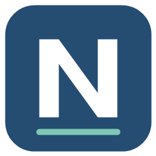
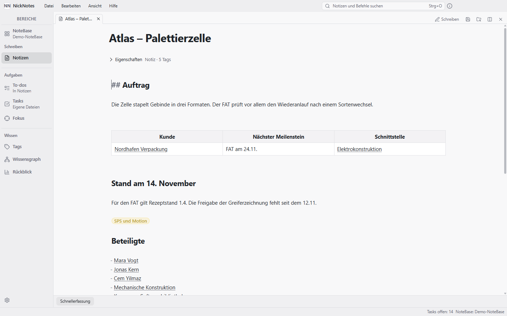
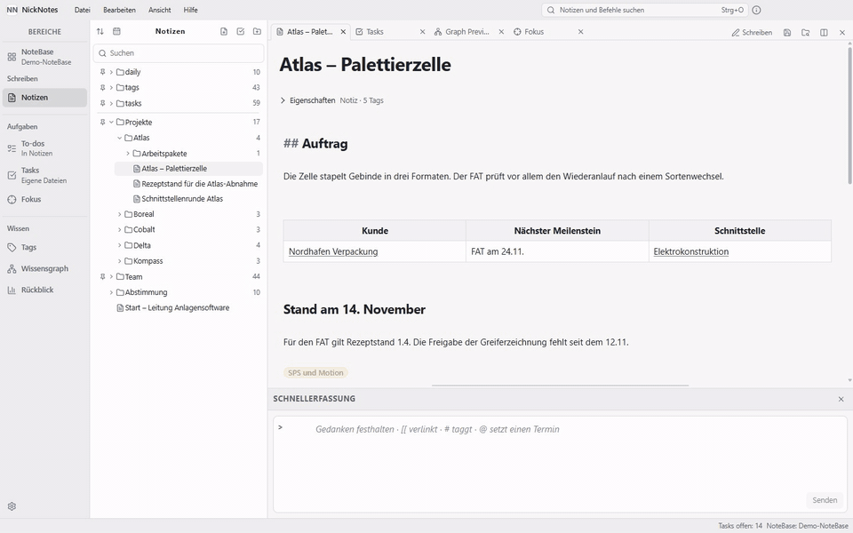
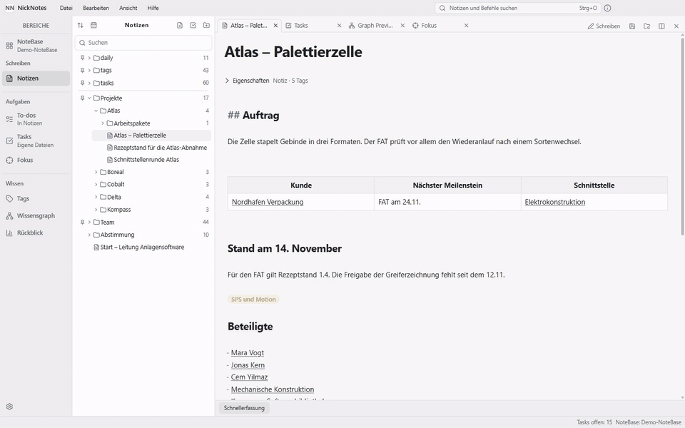
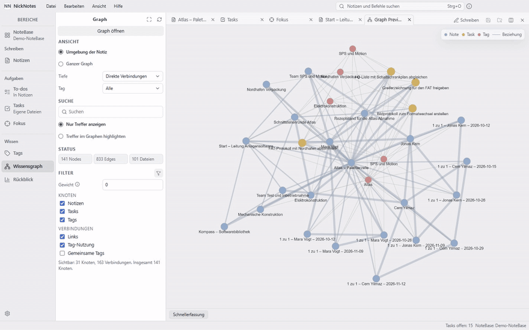
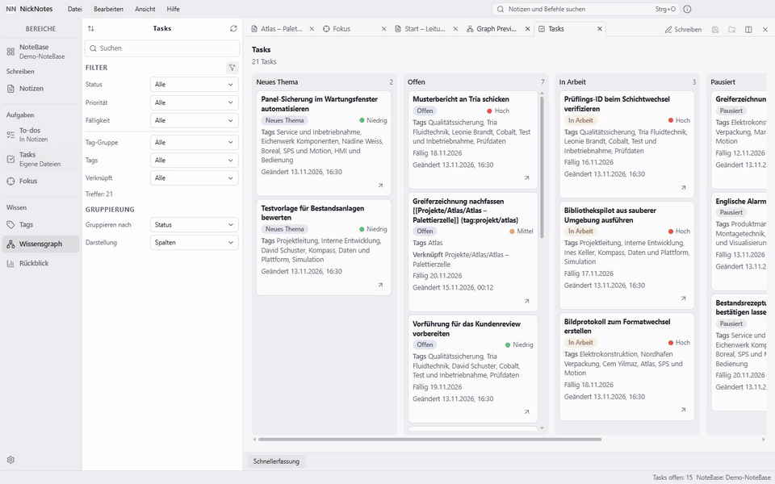
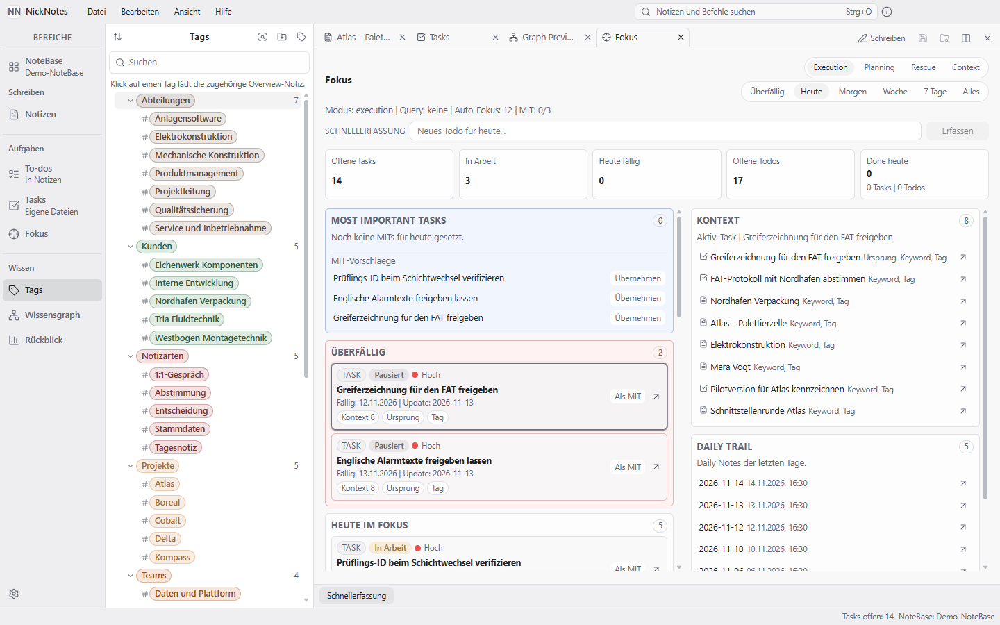
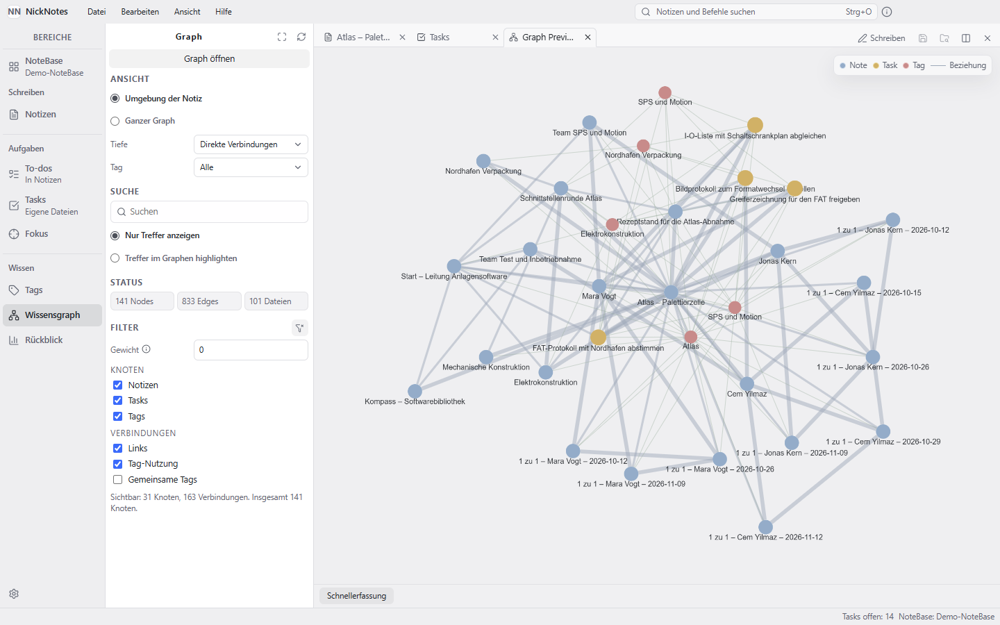

<div align="center">



# NickNotes

**Deine Notizen, Aufgaben und Gedanken – als einfache Markdown-Dateien auf deinem eigenen Rechner.**

Lokale Desktop-App für Windows mit Wissensgraph, Tasks und Zugang für KI-Agenten.
Kein Konto, keine Cloud, kein Datenformat, das dich festhält.

[](LICENSE)
[](https://github.com/DevNiklasRichter/NickNotes/actions/workflows/windows.yml)
[](https://github.com/DevNiklasRichter/NickNotes/releases)


[Download](#download) · [Funktionen](#funktionen) · [Agenten](#agenten-verbinden) · [Beispiel ausprobieren](#beispiel-notebase) · [Mitmachen](CONTRIBUTING.md)

<br>

<picture>
  <source media="(prefers-color-scheme: dark)" srcset="doc/media/note-dark.png">
  
</picture>

</div>

## Warum NickNotes?

- **Deine Daten bleiben Markdown.** Jede Notiz und jede Task ist eine Textdatei in einem Ordner,
  den du selbst wählst. Du kannst sie mit jedem Editor öffnen, mit OneDrive oder Git sichern und
  jederzeit mitnehmen. Suchindex und Graph sind nur Hilfsdaten und werden bei Bedarf neu aufgebaut.
- **Schnell und ruhig.** Eine kompakte, vollständig per Tastatur bedienbare Oberfläche in Hell und Dunkel.
  Auch große NoteBases öffnen und speichern zügig.
- **Notizen und Aufgaben an einem Ort.** Aus einer Notiz heraus entstehen To-dos, eigenständige Tasks
  bekommen Status, Priorität und Fälligkeit – alles bleibt verknüpft.
- **Lokal und offline.** NickNotes funktioniert ohne Internet und ohne Konto. Agenten wie Claude Code
  erreichen deine NoteBase nur über eine Freigabe, die du selbst erstellst und jederzeit widerrufst.

## Funktionen

### Schnellerfassung: Gedanken festhalten, bevor sie weg sind

Mit **Strg+Umschalt+Leertaste** öffnet sich ein Eingabefeld. `[[` verlinkt eine Notiz, `#` setzt einen Tag,
`@` ein Datum wie „morgen“, „Freitag“ oder „20.11.“. Aus `- [ ] Angebot schicken @morgen` wird
automatisch eine Task mit Fälligkeitsdatum. Ein nicht abgesendeter Entwurf geht nie verloren.

<p align="center"></p>

### Alles sofort finden

**Strg+O** durchsucht Notizen und App-Befehle in einem gemeinsamen Suchfeld. Die Volltextsuche
läuft auf einem lokalen SQLite-Index mit FTS5.

<p align="center"></p>

### Wissensgraph: sehen, wie deine Notizen zusammenhängen

Der Graph zeigt zuerst die Umgebung der geöffneten Notiz – mit wählbarer Tiefe und Tag-Filter.
Notizen, Tasks und Tags sind verschiedenfarbige Knoten; Links, Rückverweise und gemeinsame Tags
werden zu Verbindungen. „Ganzer Graph“ bleibt einen Klick entfernt.

<p align="center"></p>

### Tasks als Board oder Liste

Eigenständige Tasks haben Status, Priorität, Fälligkeit und Tags. Du gruppierst und filterst nach
Status, Priorität, Fälligkeit oder Tags und wechselst zwischen Spalten und Liste.
Der Bereich **Fokus** zeigt, was heute dran ist.

<p align="center"></p>

### Tags mit Struktur

Tags sind eindeutig als `gruppe:tag` definiert, im Text als `{tag:projekt/atlas}` referenziert und
zentral in `.system/tag_groups.json` gepflegt. Jeder Tag bekommt eine eigene Übersichtsnotiz.

<picture>
  <source media="(prefers-color-scheme: dark)" srcset="doc/media/tags-dark.png">
  
</picture>

### Mehr

- **Fokus und Rückblick** als eigene Bereiche neben Notizen und Tasks
- **Schreibmodus**, der Seitenleisten ausblendet, ohne dass ein Entwurf verloren geht
- **Geteilte Ansicht** mit mehreren Editorgruppen und Registerkarten
- **Absturzsicher**: Entwürfe, Tags und Task-Abschlüsse sind gegen Abbrüche mitten im Schreiben geschützt;
  gelöschte NoteBases landen im Windows-Papierkorb
- **OneNote-Import** für den Umstieg
- **Komplett per Tastatur bedienbar**, mit Befehlsübersicht auf **F1** – siehe [Tastatur und Menüs](doc/keyboard-and-menus.md)
- **Updates auf Wunsch**: signierte Pakete prüfen auf neue stabile Versionen, installiert wird nur nach deiner Bestätigung

## Download

Den aktuellen Installer gibt es unter [**GitHub Releases**](https://github.com/DevNiklasRichter/NickNotes/releases):
`NickNotes-Setup-<Version>-x64.exe` für Windows (x64) herunterladen und ausführen.

- Installation pro Benutzer mit wählbarem Zielordner – Node.js und Python werden **nicht** benötigt.
- Beim ersten Start eine NoteBase anlegen oder einen bestehenden Ordner öffnen. Die NoteBase liegt getrennt
  von der Installation und bleibt bei der Deinstallation erhalten.
- Solange es noch keine stabile Version gibt, sind die Veröffentlichungen Testkandidaten (RC). Lege vor einem
  Versionswechsel eine Sicherung deiner NoteBase an.
- Was die Pakete enthalten und wie sie entstehen: [Windows-Auslieferung](doc/windows-release.md).

## Agenten verbinden

NickNotes hat keinen eingebauten Chat und ruft selbst kein Sprachmodell auf. Stattdessen stellt die App einen
lokalen, authentifizierten **MCP-Server** bereit. Damit können Claude Code, Codex und andere MCP-Clients
Notizen lesen, durchsuchen und – wenn du es erlaubst – schreiben.

1. **Einstellungen → MCP** öffnen.
2. Eine benannte Freigabe erstellen. Standard ist **nur Lesen**; Schreiben schaltest du bewusst dazu.
3. Die angezeigte Konfiguration in den Client übernehmen.

Jede Freigabe gilt für genau **eine** NoteBase und lässt sich jederzeit widerrufen. Ein kleiner Hintergrunddienst
macht die NoteBase auf Wunsch auch erreichbar, wenn die App geschlossen ist.
Die Anleitung mit Beispielen: [MCP-Verbindungen](doc/mcp-connections.md).

<picture>
  <source media="(prefers-color-scheme: dark)" srcset="doc/media/graph-dark.png">
  
</picture>

## Beispiel-NoteBase

Unter [`examples/demo-notebase`](examples/demo-notebase) liegt eine vollständig erfundene NoteBase
(die Anlagenbau-Abteilung der fiktiven „Falkenried Maschinenbau AG“) mit Projekten, Besprechungen, Tasks und
Tags. Kopiere den Ordner an einen beliebigen Ort und öffne ihn in NickNotes über **NoteBase laden**, um alle
Funktionen auszuprobieren. Alle Bilder und GIFs in diesem README stammen aus genau dieser NoteBase.

## So funktioniert es

```text
NoteBase/                  ← dein Ordner, normale Markdown-Dateien
├── Projekte/…             ← Notizen in deiner eigenen Ordnerstruktur
├── tasks/…                ← eigenständige Tasks
└── .system/tag_groups.json   ← zentrale Tag-Definition

%LOCALAPPDATA%/NickNotes/  ← nur auf diesem PC: Suchindex, Graph, Agent-Freigaben
```

Markdown-Dateien sind die einzige Quelle der Wahrheit. Index, Graph und Übersichten lassen sich daraus
jederzeit neu aufbauen – deshalb synchronisiert OneDrive nur, was du selbst angelegt hast.
Die Details stehen in der [Architektur](doc/PROJECT_ARCHITECTURE.md).

## Technik

| Bereich | Technik |
| --- | --- |
| Oberfläche | React, TypeScript, Vite, CodeMirror |
| Desktop | Electron |
| Backend | Python, FastAPI, Uvicorn |
| Suche und Projektionen | SQLite mit FTS5 |
| Agentenzugang | Model Context Protocol (MCP) über Streamable HTTP |
| Paketierung | electron-builder, Windows-Installer (NSIS) |

## Selbst bauen und mitmachen

Fehler, Ideen und Pull Requests sind willkommen. Wie du NickNotes lokal startest, testest und paketierst,
steht in [CONTRIBUTING.md](CONTRIBUTING.md). Für Fragen zur Struktur beginnt man am besten bei der
[Architektur](doc/PROJECT_ARCHITECTURE.md). Sicherheitsprobleme bitte nach [SECURITY.md](SECURITY.md) melden.

Weitere Dokumentation in [`doc/`](doc): [Wissensgraph](doc/graph-feature.md) ·
[Start und Wiederherstellung](doc/startup-and-recovery.md) · [Oberflächen-Styleguide](doc/ui-styleguide.md) ·
[GitHub-Pipeline](doc/github-pipeline.md)

Was sich geändert hat, steht im [Changelog](CHANGELOG.md).

## Code-Signatur und Datenschutz

### Code signing policy

Die bisherigen Veröffentlichungen sind Testkandidaten und **nicht signiert**. Windows zeigt
deshalb beim Installieren eine SmartScreen-Warnung („Unbekannter Herausgeber“). Die Prüfsummen
(`SHA256SUMS.txt`) liegen jedem Release bei. Für stabile Versionen soll kostenlose Code-Signatur der
[SignPath Foundation](https://signpath.org/) beantragt werden. Sobald die Aufnahme bestätigt ist,
steht an dieser Stelle der vorgeschriebene Hinweis: *Free code signing provided by
[SignPath.io](https://signpath.io), certificate by [SignPath Foundation](https://signpath.org).*

Vorgesehene Regeln für signierte Veröffentlichungen:

- **Nur eigener Code:** Signiert wird ausschließlich der Windows-Installer, der in diesem Repository
  aus dem Quellcode und den hier liegenden Build-Skripten entsteht. Gebaut wird in GitHub Actions
  aus einem Versionstag; es wird nichts signiert, was lokal gebaut oder von Dritten geliefert wurde.
- **Manuelle Freigabe:** Jede Signatur wird von einer Person aus der Rolle „Approver“ einzeln
  bestätigt.
- **Rollen:** Autor, Committer, Reviewer und Approver ist derzeit der Maintainer
  [@DevNiklasRichter](https://github.com/DevNiklasRichter). Änderungen von anderen Personen kommen
  nur über einen Pull Request in `main`, der vor dem Merge geprüft wird; `main` ist durch Ruleset und
  grüne Windows-CI geschützt.
- **Zwei-Faktor-Anmeldung** ist für GitHub und SignPath Pflicht.
- **Keine Schadsoftware:** NickNotes enthält keine Werkzeuge zum Aufspüren oder Ausnutzen von
  Schwachstellen und verändert das System nur durch die normale Installation pro Benutzer
  (Deinstallation über Windows-Einstellungen). Verdachtsfälle bitte nach [SECURITY.md](SECURITY.md) melden.

### Datenschutz

NickNotes hat kein Konto, keine Telemetrie und lädt keine Notizen hoch. Ihre NoteBase bleibt auf
Ihrem Rechner. Die App verbindet sich nur in diesen Fällen mit dem Netzwerk:

- **Updateprüfung (nur signierte Pakete):** Etwa 30 Sekunden nach dem Start und danach alle vier Stunden
  fragt NickNotes bei GitHub Releases nach einer neueren stabilen Version. Dabei sieht GitHub, wie bei
  jedem Webzugriff, Ihre IP-Adresse und die angefragte Datei. NickNotes sendet keine Notizen,
  Einstellungen oder Gerätekennungen. Heruntergeladen und installiert wird nur nach Ihrer
  Bestätigung. In unsignierten Testpaketen ist die Updatefunktion abgeschaltet.
- **Lokale Dienste:** Das Backend und die MCP-Schnittstelle für Agenten lauschen nur auf dem lokalen
  Loopback (`127.0.0.1`) und sind durch Schlüssel geschützt. Eine Agentenfreigabe erteilen Sie selbst
  und können sie jederzeit widerrufen.

## Lizenz

[MIT](LICENSE) © Niklas Richter. Die Lizenzen mitgelieferter Drittanbieter-Komponenten bleiben gültig.
